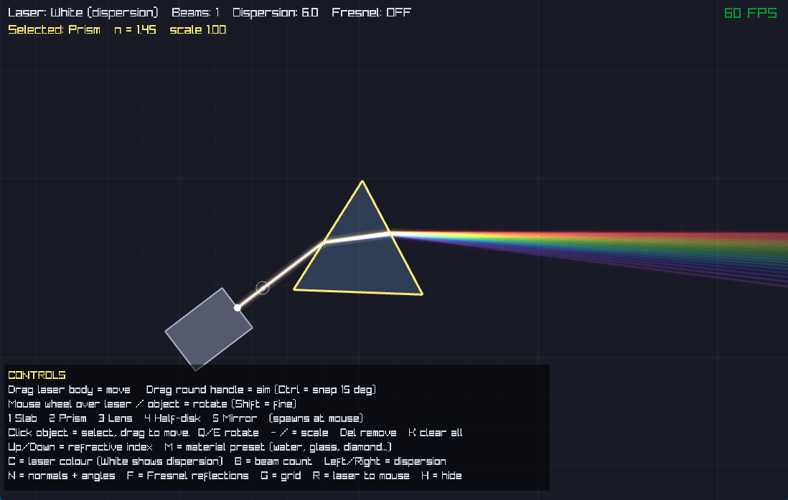
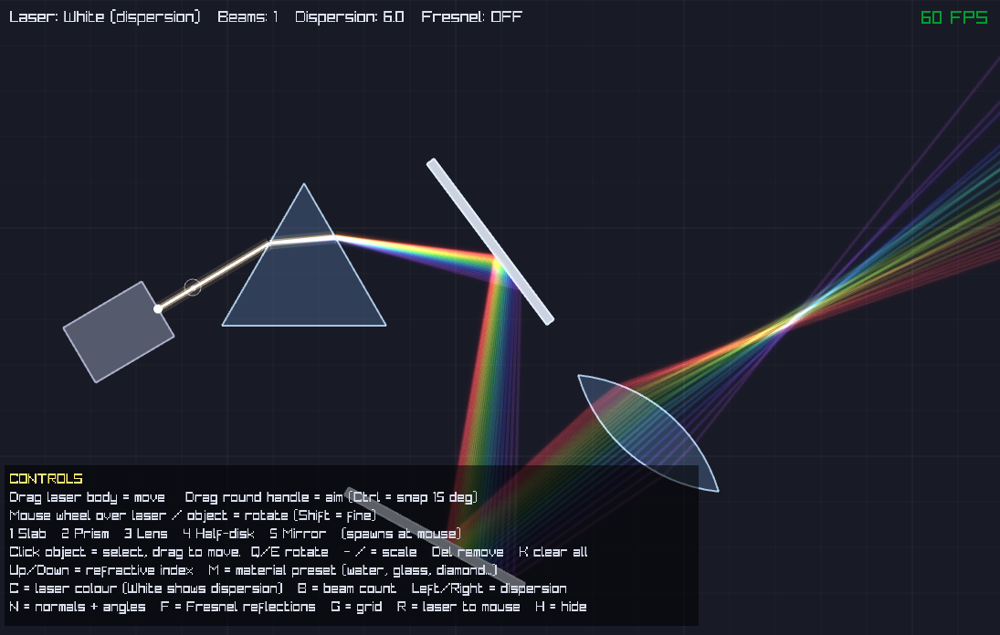

# refraction-sim
Idk i made this on a saturday with two chocolate milkshakes its kinda cool i learned about snell's formula at school today so i decided to make this also its made with raylib
Here are some pictures: 

Heres a picture of the many systems you can make!

